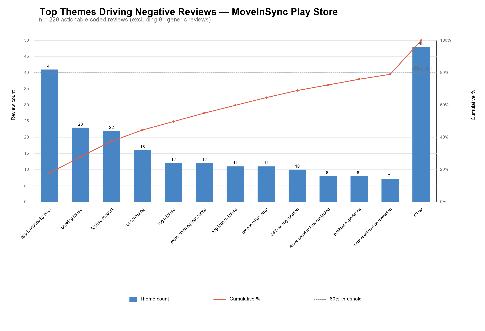
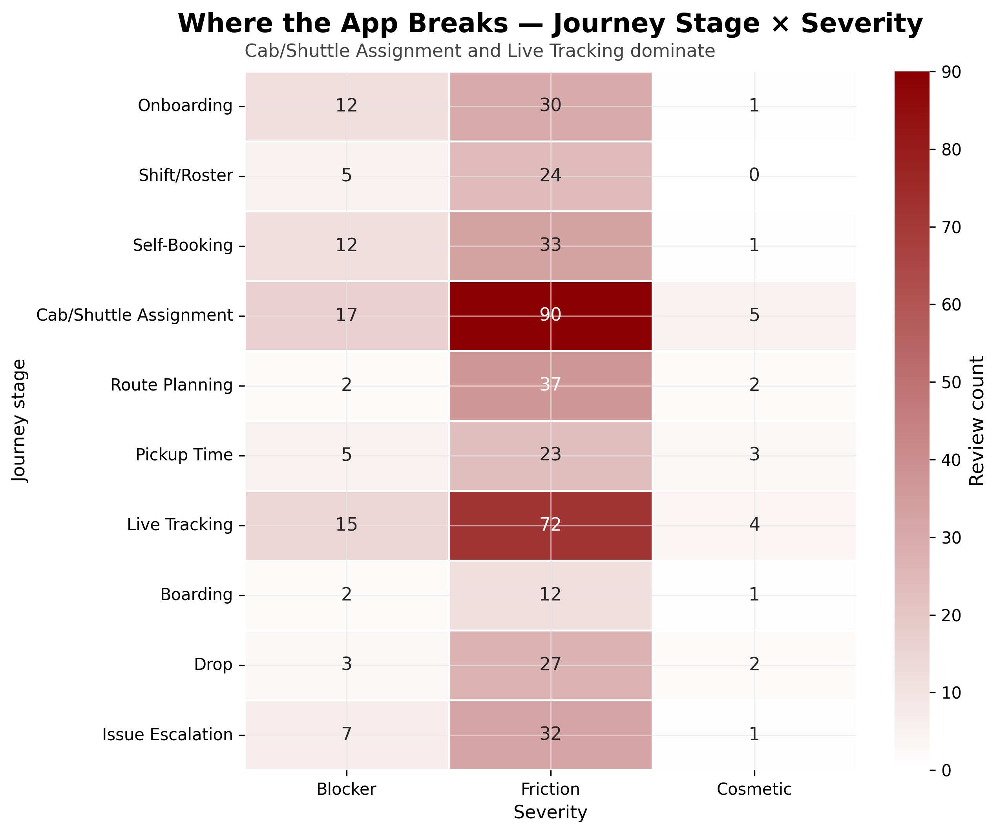
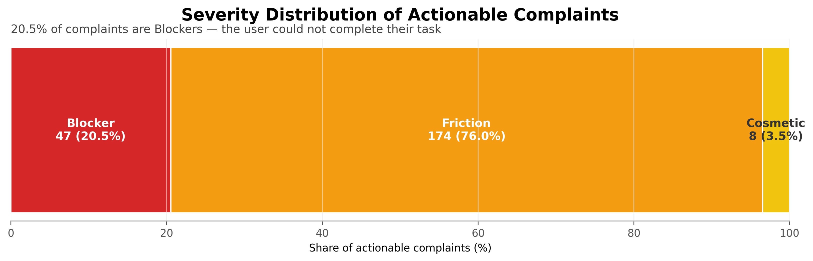

# MoveInSync Play Store Rating — Case Study Submission

October 12, 2026
Looknath Das

# Table of Contents

1. Executive Summary
2. Findings — Why the Rating Is Where It Is
3. Rating-Lift Model — What Moves the Needle
4. Prioritized Backlog — What to Fix, in Order
5. Sprint-Ready P0 Fix Spec
6. Monitoring Playbook — Keeping the Answer Fresh

# 1. Executive Summary

# Executive Memo: Play Store Rating Recovery

## 1. The Problem

Play Store displays 4.64★ (metadata: 4.6382785 across 114,872 ratings). The 24,314-review sample averages 3.61★; its 2024–2026 reviews average 3.71★. Of the sample, 6,352 reviews (26.1%) are 1★. The 1.03★ gap shows that the cumulative headline, shaped by historical ratings, overstates the recent user experience.

## 2. The Root Cause

Coding 320 reviews against the case study journey taxonomy found that the five largest themes account for 114 of 229 actionable reviews (49.8%). App-fix labels cover 290 of all 320 coded rows (90.6%), placing most coded issues within engineering's control. The Help Center documents standard support flows for crashes, login and OTP failures, and GPS loss. Employee reviews rate AmbitionBox 3.1/5 (293 reviews) and Glassdoor 3.0/5 (223 reviews), with comments describing pressure and shifting priorities; these are context, not proof of product causation. The company blog documents personalized replies in a prior recovery; current reply coverage is unverified.

## 3. The Recommendation

**Track A — P0, Sprint 1–2 (4 weeks):** Ship four low-effort, high-frequency fixes: booking-state persistence, cancellation confirmation, OTP and notification reliability, and the top three feature requests. Stop the bleeding.

**Track B — P0, parallel:** Rebuild the review pipeline with in-app prompts after successful trips at positive moments and a 100% Play Store reply SLA for 1★–2★ reviews within 7 days.

**Track C — P1, this quarter:** Deliver crash remediation, GPS/ETA improvements, and enterprise transport-desk outreach.

**Track D — ongoing:** Replace reliance on the displayed rating with the monitoring playbook's leading indicators: rolling 90-day rating, blocker rate, theme mix, review velocity, 5★ share, reply rate, and enterprise retention.

## 4. The Proof

The figures trace to [coded reviews](../02_analysis/coded_reviews.csv), [Play Store metadata](../01_raw_data/moveinsync_metadata.json), and the cited analysis and source files. Supporting charts, prioritized backlog, P0 specification, and monitoring playbook are included in the submission.

*The displayed rating is a legacy indicator of past product states. The recommendation is to fix what users experience now, and to track what actually predicts enterprise retention.*

---

# 2. Findings — Why the Rating Is Where It Is

## 1. The Headline Number Is Misleading

The authoritative Play Store metadata snapshot reports a 4.6382785 rating across 114,872 ratings, retrieved 2026-10-11; rounded to two decimals, the displayed rating is 4.64 stars. The separate text sample of 24,314 reviews dated 2014 through October 2026 averages 3.61 stars, a 1.03-star gap. This is a long-window sample, not 24,314 recent reviews. The 2024–2026 subset averages 3.71, 0.93 below 4.64. Of the sample, 6,352 reviews are 1-star (26.1%), 1,165 are 2-star (4.8%), 1,089 are 3-star (4.5%), 2,794 are 4-star (11.5%), and 12,914 are 5-star (53.1%). The [data summary](../01_raw_data/data_summary.md) notes the scraper’s pagination cap. The gaps are consistent with a cumulative rating reflecting a more positive historical mix, though the files do not decompose the rating by review vintage.

## 2. Where the App Breaks (The Journey-Stage Diagnosis)

The coding exercise covered 320 reviews using the case study’s ten-stage employee journey taxonomy. Ninety-one were generic, leaving 229 actionable reviews. The five largest themes—app functionality error (41), booking failure (23), feature request (22), confusing UI (16), and login failure (12)—sum to 114, or 49.8% of actionable reviews. The [Pareto table](chart_data.md) and the row-level [coded dataset](coded_reviews.csv) support these counts.

Cab/Shuttle Assignment and Live Tracking dominate the journey diagnosis. The severity-by-stage matrix records 112 Cab/Shuttle Assignment mentions and 91 Live Tracking mentions. Relative to all 320 coded rows, those counts are 35.0% and 28.4%. They are stage mentions rather than exclusive categories because a review may refer to multiple stages. De-duplicating at the review level, 144 of 229 actionable reviews (62.9%) mention at least one of the two stages. A failure here can disrupt a time-sensitive commute, not just add interface friction.

Forty-seven actionable reviews are Blockers, 20.5% of the 229: the user cannot complete a task. The remaining actionable reviews are 174 Friction and eight Cosmetic. Fixability also depends on the denominator. In all 320 coded rows, 290 are labeled App-fix (90.6%), 16 Employer-policy (5.0%), and 14 vendor-related (4.4%), including four uncertain Vendor-ops (?) labels. Among actionable reviews, App-fix is 200 of 229 (87.3%), Employer-policy is 16 (7.0%), and vendor-related labels total 13 (5.7%), including those uncertain cases. Engineering therefore has the largest direct lever, but 90.6% applies to all coded rows, not actionable complaints, and the fixability labels are not proof that every issue is solely an app defect.

## 3. What Users Actually Say (Verbatim Signals)

These ten excerpts are copied from the coded-review CSV. They illustrate distinct failure modes; they are evidence of what reviewers reported, not estimates of prevalence.

**Booking failures**

> This application does not show log out if we stretch as it shows only ad hoc and even after booking adhoc the cab is not alloted. — [row_id 19105](coded_reviews.csv#L7)

**Crash and lifecycle failures**

> The app frequently crashes or hangs while booking cabs, which makes it really frustrating, especially when I’m in a hurry. — [row_id 3073](coded_reviews.csv#L14)

> The app crashes frequently in first place. — [row_id 7415](coded_reviews.csv#L10)

> It worked for 2 days after installation but now app itself is not opening (shows only opening screen). — [row_id 12020](coded_reviews.csv#L4)

**Cancel without confirmation**

> It doesn't even provide cancellation option. — [row_id 23638](coded_reviews.csv#L22)

**GPS and ETA inaccuracy**

> The location needs to be improved, it's showing the wrong location even after a long time. — [row_id 12794](coded_reviews.csv#L169)

> Gives false information on pickup and arrival time. — [row_id 17754](coded_reviews.csv#L27)

**Login and OTP failures**

> After the recent update, Whenever I try to login for checking the cab details the text box entering the otp doesn't appear. — [row_id 5753](coded_reviews.csv#L34)

> I am not receiving the OTP even after trying multiple times. — [row_id 115](coded_reviews.csv#L77)

**Driver contact**

> Could not call the bus driver at critical time, as if I click on the call button, it says like The company policy is not allowed to call. — [row_id 3529](coded_reviews.csv#L30)

## 4. The Root Cause Is Upstream of the App

**Help Center (verified 2026-10-12).** MoveInSync’s [Mobile App Issues article](https://helpcenter.moveinsync.com/support/solutions/articles/1070000136108-mobile-app-issues) lists login/OTP, crash, launch/splash-screen, network, and unresponsive-page issues. Its response steps include checking account details and permissions, updating or reinstalling, clearing cache, restarting, collecting logs, and escalating persistent failures. A separate [GPS-loss article](https://helpcenter.moveinsync.com/support/solutions/articles/1070000086664-how-to-identify-in-the-system-if-a-trip-has-faced-gps-loss-) was found by searching “GPS” and verified on 2026-10-12 ([screenshot](../01_raw_data/helpcenter_gps_screenshot.png)). It instructs staff to inspect a trip route in legacy view with the Speed overlay and use Device Health logs to check `IsGPSOn`, GPS coordinate accuracy (under 50 meters is treated as accurate), and gaps indicating that the driver app may have been killed. It also documents billing remediation through Flagged Vehicles (Data incomplete) and Resolve Issues/Fix actions. This is an operations-facing GPS-loss diagnostic and recovery workflow, not proof of a specific rider-app defect rate.

**Employee reviews (screenshots verified 2026-10-12).** [AmbitionBox](../01_raw_data/employee_reviews_screenshot1.png) shows 3.1/5 from 293 reviews; one reviewer wrote, “I rated the company low because based on my experience, the work culture is quite poor and there is little to no work-life balance.” [Glassdoor](../01_raw_data/employee_reviews_screenshot2.png) shows 3.0/5 from 223 reviews; a reviewer cited “frequent complaints regarding top-down pressure, micromanagement, ad-hoc task shifting, and strict leadership decorum issues.” These are individual employee perceptions, not causal evidence about app defects or a representative culture estimate.

**MoveInSync’s prior response (source checked 2026-10-12).** The company’s [rating-recovery blog](../01_raw_data/company_blog_rating_recovery.md) links technical glitches to a historical rating drop from 4.6 to 4.3 and describes changing review replies during recovery. It says, “We decided to say no to canned responses!” and that personalized replies helped “change the mind of several users who had initially rated us with 1.” This documents a past practice; current reply cadence is unknown.

**Mastodon (post dated 2025-05-08; screenshot verified 2026-10-12).** Ranjit Mathew (@rmathew) wrote, “Bug-reports via the app, email-feedback, etc. seemingly go to /dev/null.” A follow-up says the app crashes often on iOS and that colleagues have complained. This is attributable evidence of perceived feedback failure and crashes.

**Enterprise scale (case study brief, page 1).** The brief states that MoveInSync serves 430+ enterprise customers, enabling coordinated communication through client transport desks. Together, these sources support an operating priority: instrument failures, close the loop on reports, and make ownership visible across engineering and enterprise support. They do not establish one code-level root cause.

## 5. The Rating Cannot Be Fixed by Bug Fixes Alone

The [two-lever model](rating_lift_model.md) separates reducing negative reviews from increasing positive reviews. Its Base case assumes fixes prevent 3.8 one-star reviews per month across the modeled top-five themes and prompts add 24 five-star reviews per month; ordinary incoming reviews are assumed to average 4.3 stars. Starting from 4.64, this mix projects 4.6372 at six months (a change of −0.0028 points), 4.6344 at 12 months, 4.6291 at 24 months, and 4.6146 at five years. Because the assumed ordinary-review average is below the starting rating, the projection trends down toward a 4.418 long-run ceiling; it crosses below 4.5 after approximately 66 years and remains above 4.4 in the long run. These are assumption-driven projections, not measured results or guarantees.

The faster-review-pipeline scenario triples monthly review volume to 684 and assumes 60% of new reviews are 5-star. Using the model’s implied 4.6936-star mean for that stream, it projects 4.6425 at six months, 4.6449 at 12 months, and 4.6492 at 24 months. Prompting is the modeled way to change the incoming review mix at scale, but these outcomes depend on the assumed 60% five-star share and the inferred non-five-star average; they are not guaranteed.

The displayed average is a cumulative, lagging measure of past ratings, not a live measure of today’s product. The more recent 3.71 sample mean is timelier, but remains subject to review-selection bias and is not a user-level satisfaction measure. The practical conclusion is not that bug fixes are futile; it is that fixing defects protects users and limits new damage, while the large historical denominator prevents those fixes alone from quickly changing the headline.

## 6. What This Means for the Recommendation

Two tracks should run in parallel. **Track A (P0, Sprint 1–2)** is a user-facing damage-control tranche: booking-state persistence, cancellation-confirmation UX, OTP and notification reliability, and the three best-supported feature requests. These actions protect task completion and reduce future complaints; they should not be sold as a material lift to the lifetime rating. This is a proposed re-cut, not the exact current artifact state: the [prioritized backlog](../03_recommendations/prioritized_backlog.md) currently puts cancellation in a P1 workstream, while the [release-stability ticket](../03_recommendations/sprint_spec_p0.md) separately labels crash remediation P0 and estimates six to eight weeks. Reconcile those artifacts before sprint commitment so launch and crash prevention remain covered and the four-item Sprint 1–2 scope is deliverable.

**Track B (P0, parallel)** rebuilds the review pipeline. Offer an in-app post-trip rating prompt after a successfully completed trip and a positive service signal, never during a failure or as a condition of using the app. Measure prompt exposure, completion, review velocity, and star mix. The model’s 24 additional 5-star reviews per month is an assumption to validate, not an outcome guaranteed by shipping a prompt.

**Track C (P1)** uses enterprise transport desks to encourage reviews after good trips. The channel has a reported reach (430+ enterprise customers, per the case study brief). **Track D (ongoing)** reduces dependence on a lifetime display score by tracking rolling 90-day rating, Blocker-review rate, theme-mix trend, review velocity, and enterprise retention. Review these measures monthly, tie movements to releases and interventions, and keep review ratings distinct from retention outcomes.

*The goal is not to move the displayed rating. It is to move the underlying metrics that determine enterprise retention and long-term brand health.*

---

---

# 3. Rating-Lift Model — What Moves the Needle

# Rating-Lift Model: Two Levers

## Baseline and assumptions

| Input | Value |
| --- | ---: |
| Starting Play Store reviews | 115,000 |
| Starting displayed rating | 4.64 |
| Starting cumulative star sum (115,000 x 4.64) | 533,600 |
| Monthly new reviews | 228 |
| Six-month organic new reviews (228 x 6) | 1,368 |
| Coded sample | 320 |
| Actionable coded reviews (excluding 91 generic) | 229 |
| Coded-review sampling window | Approximately 18 months |
| Monthly 5-star reviews (228 x 0.53) | Approximately 121 |

The top-five theme counts are from the Pareto table in `chart_data.md`. For the star-sum projection, ordinary incoming reviews are assumed to average 4.3 stars (held constant from the prior model assumption), prevented negative reviews are assumed to be 1-star, and each additional prompted review is assumed to be 5-star. Positive-review gains use the supplied rounded estimate of +24 per month in the base case, scaled proportionally to +12 and +36 per month in the pessimistic and optimistic cases. These are expected-value estimates, so prevented-review counts and projected totals can be fractional. The starting rating and star sum use the authoritative metadata value rounded to 4.64.

## Lever 1: Reduce negative reviews

Monthly complaints = `n_theme / 18`. Monthly reductions apply the scenario's reduction rate to that complaint estimate.

| Pareto rank | Theme | n_theme | Monthly complaints | Pessimistic reduction (30%) | Base reduction (60%) | Optimistic reduction (80%) |
| ---: | --- | ---: | ---: | ---: | ---: | ---: |
| 1 | app functionality error | 41 | 2.2778 | 0.6833 | 1.3667 | 1.8222 |
| 2 | booking failure | 23 | 1.2778 | 0.3833 | 0.7667 | 1.0222 |
| 3 | feature request | 22 | 1.2222 | 0.3667 | 0.7333 | 0.9778 |
| 4 | UI confusing | 16 | 0.8889 | 0.2667 | 0.5333 | 0.7111 |
| 5 | login failure | 12 | 0.6667 | 0.2000 | 0.4000 | 0.5333 |
| **Total** | **Top five** | **114** | **6.3333** | **1.9000** | **3.8000** | **5.0667** |

## Lever 2: Increase positive reviews

| Scenario | 5-star review boost | Additional 5-star reviews per month | Additional 5-star reviews over 6 months |
| --- | ---: | ---: | ---: |
| Pessimistic | 10% | 12 | 72 |
| Base | 20% | 24 | 144 |
| Optimistic | 30% | 36 | 216 |

## Combined six-month projection

Negative reviews prevented = top-five monthly reductions x 6. New review total = `115,000 + 1,368 - prevented + additional positive reviews`. New star sum = `533,600 + (1,368 x 4.3) - prevented + (additional positive reviews x 5)`.

| Scenario | Negative reduction | Positive boost | Negative reviews prevented (6 mo) | Additional 5-star reviews (6 mo) | New total reviews | New cumulative star sum | Projected rating |
| --- | ---: | ---: | ---: | ---: | ---: | ---: | ---: |
| Pessimistic | 30% | 10% | 11.4 | 72 | 116,428.6 | 539,831.0 | 4.636584138 |
| Base | 60% | 20% | 22.8 | 144 | 116,489.2 | 540,179.6 | 4.637164647 |
| Optimistic | 80% | 30% | 30.4 | 216 | 116,553.6 | 540,532.0 | 4.637625951 |

## Base scenario: extended projections

The monthly Base rates are held constant: 228 organic new reviews, 3.8 negative reviews prevented, and 24 additional 5-star reviews. For each horizon, new total reviews = `115,000 + organic new reviews - negative reviews prevented + additional positive reviews`. Cumulative star sum = `533,600 + (organic new reviews x 4.3) - negative reviews prevented + (additional positive reviews x 5)`.

| Horizon | Total new organic reviews | Negative reviews prevented | Additional positive reviews | Cumulative new total N | Cumulative star sum | Projected rating |
| --- | ---: | ---: | ---: | ---: | ---: | ---: |
| 12 months | 2,736 | 45.6 | 288 | 117,978.4 | 546,759.2 | 4.634400873 |
| 24 months | 5,472 | 91.2 | 576 | 120,956.8 | 559,918.4 | 4.629077489 |
| 5 years (60 months) | 13,680 | 228.0 | 1,440 | 129,892.0 | 599,396.0 | 4.614572106 |

## Long-run rating thresholds

At constant monthly rates, the rating is `(533,600 + 1,096.6 x months) / (115,000 + 248.2 x months)`, which approaches a ceiling of `1,096.6 / 248.2 = 4.418211` as time increases.

| Threshold | Result under constant Base rates |
| --- | --- |
| 4.4 | Remains above 4.4; the 4.418211 long-run ceiling is higher |
| 4.5 | Falls below 4.5 after approximately 793 months, or 66.1 years |

## Review Pipeline Rebuilt scenario

This scenario assumes 684 gross new reviews per month, with 60% receiving 5 stars. The remaining 40% are modeled at 4.234043 stars, inferred from the current 4.64 average and 53% 5-star share: `(4.64 - 0.53 x 5) / 0.47`. The implied average for all 684 new reviews is 4.693617 stars. The 24 prompt-driven positive reviews per month are already included in the 684 and are not added a second time. The same 3.8 prevented 1-star reviews per month are subtracted from both review count and star sum.

| Scenario | Horizon | Gross new reviews | Negative reviews prevented | 5-star reviews (60% of gross) | Cumulative new total N | Cumulative star sum | Projected rating |
| --- | --- | ---: | ---: | ---: | ---: | ---: | ---: |
| Review Pipeline Rebuilt | 6 months | 4,104 | 22.8 | 2,462.4 | 119,081.2 | 552,839.8 | 4.642544787 |
| Review Pipeline Rebuilt | 12 months | 8,208 | 45.6 | 4,924.8 | 123,162.4 | 572,079.6 | 4.644920922 |
| Review Pipeline Rebuilt | 24 months | 16,416 | 91.2 | 9,849.6 | 131,324.8 | 610,559.2 | 4.649230130 |

---

---

# 4. Prioritized Backlog — What to Fix, in Order

# Prioritized Fix Backlog

## Execution-order rules

This backlog sequences work by frequency, effort, dependencies, and blocker volume rather than severity alone. The high-frequency cutoff for Sprint 1-2 is 16 coded mentions, the lowest count among the selected P0 items. No viral trigger is established by the review data. P0 work is limited to four high-volume, S/M workstreams; the OTP/notification item is pulled forward because it includes 9 Blockers, with required messaging/auth coordination started in Sprint 1. P1 collects four larger or dependency-heavy workstreams; remaining low-volume, small efforts are P2.

Counts and severity mixes come from mutually exclusive theme labels in `02_analysis/coded_reviews.csv`. This table accounts for 221 actionable, non-positive reviews: 47 Blocker and 174 Friction. The 91 generic reviews and 8 positive-experience reviews are excluded from the fix count.

`†` marks a theme included in the rating-lift model's top-five set. That model estimates the five themes together: from the authoritative 4.64 starting rating, the Base case prevents 22.8 negative reviews and adds 144 prompted 5-star reviews over six months, projecting 4.6372 under its 4.3★ ordinary-inflow assumption. These figures are portfolio-level, not an individual-fix forecast.

Effort: S = 1 sprint or less; M = 1-2 sprints (up to 4 weeks); L = a quarter or more. P0 target: Sprint 1-2 (4-6 weeks). P1 target: Sprint 3-6 (8-12 weeks). P2: Quarter 2+.

## Backlog

| Priority / target | Fix or workstream | Theme(s) addressed | Coded count | Severity | Effort | Owner | Expected impact | Why this priority |
| --- | --- | --- | ---: | --- | :---: | --- | --- | --- |
| P0 / Sprint 1-2 | Stabilize app startup, runtime, and crash paths | app functionality error†; app launch failure; app crash during booking; app crash during tracking; app slow | 59 | Blocker 21; Friction 38 | M | Engineering | UX: fewer launch failures, hangs, and crashes across core tasks. Reviews: reduces repeat reliability complaints; the top-five model covers app functionality within its aggregate 22.8 prevented-review estimate. | Highest-volume cluster; contained Android-client work with no external dependency and can be delivered within four weeks. |
| P0 / Sprint 1-2 | Make booking and trip assignment transactional, with a clear confirmed state | booking failure†; booked but no trip shown; cab not assigned | 26 | Blocker 11; Friction 15 | M | Engineering | UX: users can trust that a booking created a trip and assigned vehicle. Reviews: reduces failed-booking complaints; booking failure is included in the model's top-five aggregate. | High-frequency core journey; internal service/client work, medium effort, and no required enterprise-policy change. |
| P1 / Sprint 3-6 | Simplify key booking, assignment, and tracking flows | UI confusing† | 16 | Friction 16 | M | Design | UX: reduce navigation effort and errors in core tasks. Reviews: fewer confusion-driven complaints; UI confusing is included in the top-five aggregate. | Still high-frequency, but all 16 are Friction with 0 Blockers; sequence behind the similarly high-volume OTP workstream, which has 9 Blockers. |
| P0 / Sprint 1-2 | Ship top 3 requested features: in-app call/message with driver or cab-mates; post-trip rating/feedback; employee list and boarding-point occupancy | feature request† | 22 | Blocker 3; Friction 19 | S | Design | UX: restore trip-participant communication, post-trip feedback, and passenger/boarding-point visibility. Reviews: address the clearest recurring asks in this heterogeneous theme. | Most repeated specific request clusters: trip-participant contact (3 mentions: rows 19065, 20309, 8715), post-trip rating/feedback (2: 3979, 9359), and passenger/boarding-point visibility (2: 16244, 24293). S assumes a scoped, no-dependency quick-win implementation; validate scope before commitment. |
| P0 / Sprint 1-2 | Improve OTP and trip-notification delivery reliability | login failure†; OTP delivery failure; notification failure | 25 | Blocker 9; Friction 16 | M | Engineering | UX: more reliable access, verification, and timely trip/feedback updates. Reviews: reduces lockout, missing-code, and missed-alert complaints; login failure is part of the top-five aggregate. | High volume and 9 Blockers; prioritize ahead of the 16-count, zero-Blocker UI issue. Start messaging/auth coordination immediately to keep the Sprint 1-2 target viable. |
| P1 / Sprint 3-6 | Improve location, route, and pickup-time confidence | GPS wrong location; drop location error; route planning inaccurate; ETA inaccurate; pickup time inaccurate | 42 | Friction 42 | L | Engineering | UX: more accurate pins, routes, ETAs, and pickup times; fewer missed connections and detours. Reviews: reduces repeat location and timing complaints. | Cross-service, large effort with map/geocoding and transport-data dependencies; sequence after internal reliability fixes. |
| P1 / Sprint 3-6 | Establish enterprise service recovery and vendor coordination | driver could not be contacted; driver no-show; support unresponsive | 15 | Blocker 1; Friction 14 | M | Support-Ops | UX: riders get a contact path, no-show fallback, and accountable support. Reviews: reduces unresolved safety, missed-pickup, and escalation complaints. | Requires vendor and enterprise transport-desk alignment, so it cannot ship as an app-only Sprint 1-2 change. |
| P1 / Sprint 3-6 | Align roster and cancellation behavior with employer policy | roster feature missing; cancel without confirmation | 11 | Blocker 1; Friction 10 | M | Enterprise-CS | UX: schedules and cancellation states reflect actual employee and employer rules. Reviews: prevents schedule mismatch, stale cancellation, and unwanted-pickup complaints. | Medium-sized policy/configuration work requiring enterprise validation before implementation. |
| P2 / Quarter 2+ | Make boarding OTP verification dependable and recoverable | boarding OTP failure | 2 | Blocker 1; Friction 1 | S | Engineering | UX: riders can complete boarding and trip closure without code failure. Reviews: prevents recurrence of a low-frequency but high-severity edge case. | Low occurrence and small standalone fix; sequence after the broader authentication/OTP delivery workstream. |
| P2 / Quarter 2+ | Add clear, revocable location-permission controls | forced location permission | 3 | Friction 3 | S | Design | UX: explain location needs and respect user choice. Reviews: reduces privacy and device-control complaints. | Low-volume, small-scope experience improvement; schedule after core stability and higher-dependency workstreams. |

## Sequencing notes

- Exactly 4 items are P0 and 4 workstreams are P1. P2 contains the remaining 2 low-volume, small-effort fixes.
- P1 groups coordinate related outcomes; component engineering tasks can be tracked separately beneath each workstream.
- The model's rating improvement is not attributable to individual backlog rows. P0 fixes primarily protect core task completion and reduce new failure complaints; the top-five portfolio's modeled Base result remains 22.8 prevented negative reviews and 144 additional 5-star reviews over six months.
- Positive-experience reviews should be monitored as strengths, not treated as defects.

---

---

# 5. Sprint-Ready P0 Fix Spec

# Engineering Ticket: Release Stability for Booking and Live Tracking

## 1. Title

**P0: Prevent Android launch and runtime crashes across booking and live tracking**

## 2. Owner

**Engineering — Android Mobile / Client Reliability** (proposed team; confirm the internal team name and on-call owner at kickoff).

## 3. Priority

**P0** — addresses a 59-review grouped stability cluster in the prioritized backlog, including 21 Blocker and 38 Friction reviews. The four explicitly scoped themes account for 55 coded reviews: app functionality error (41), app launch failure (11), app crash during booking (2), and app crash during tracking (1). The backlog's 59 total also includes app slow (4).

## 4. Problem statement and evidence

Users report that the app becomes unavailable after updates, hangs during startup, or crashes during core booking and tracking tasks. These failures can leave employees unable to arrange a ride or see and contact their assigned driver.

| Theme | Severity | Source review | Verbatim quote |
| --- | --- | --- | --- |
| app functionality error | Blocker | [row_id 21171](../02_analysis/coded_reviews.csv#L2) | "Not expected out of such time bounded work we do and need to reach on time to work, this causes a lot of issue with missing the cab." |
| app functionality error | Friction | [row_id 16157](../02_analysis/coded_reviews.csv#L18) | "Initially the app was working fine but after the update it's become worst." |
| app launch failure | Friction | [row_id 12020](../02_analysis/coded_reviews.csv#L4) | "It worked for 2 days after installation but now app itself is not opening (shows only opening screen)." |
| app launch failure | Blocker | [row_id 10967](../02_analysis/coded_reviews.csv#L13) | "App stuck on splash screen." |
| app crash during booking | Friction | [row_id 3073](../02_analysis/coded_reviews.csv#L14) | Excerpt: "The app frequently crashes or hangs while booking cabs" |
| app crash during tracking | Blocker | [row_id 15488](../02_analysis/coded_reviews.csv#L9) | Excerpt: "move in sync keeps stopping" |

## 5. Business impact

Stability failures affect core employee workflows and can cause missed rides, loss of live trip visibility, and inability to contact a driver. They also generate new low-star complaints and undermine enterprise confidence in the service.

The rating-lift model places app functionality error (41 coded reviews) inside its top-five portfolio. Starting from the authoritative 4.64 rating, the model's Base case estimates 22.8 negative reviews prevented over six months and 144 additional prompted 5-star reviews, projecting 4.6372 because ordinary incoming reviews are assumed to average 4.3. This is a portfolio-level estimate; the model does **not** isolate the rating impact of this stability fix.

## 6. Root cause hypothesis

**Hypothesis, not confirmed cause:** release changes may be introducing regressions that escape booking, tracking, and cold-start regression coverage. Reports include crashes or startup failure after an update (row_ids 16157, 15488), an app that stops opening after two days (12020), and splash-screen hangs (10967). This is consistent with gaps in release-specific instrumentation, lifecycle/network/error-path coverage, or a crash-free release gate.

The coded reviews do not establish whether a crash-free gate currently exists, identify a responsible code change, or demonstrate an iOS QA gap. Validate those points by reviewing recent release crash telemetry, CI gates, and regression coverage before attributing root cause.

## 7. Proposed fix

1. **Instrument crashes and non-fatal failures.** Integrate Firebase Crashlytics (or the existing approved Sentry deployment). Tag events with app version, Android API level, device model, and flow (`startup`, `booking`, `tracking`); do not include trip, employee, or other sensitive identifiers. Establish pre-change crash-free-session and crash-rate baselines.
2. **Gate staged promotion on stability.** Define crash-free sessions >99.5% over a rolling 14-day window for the eligible cohort. A release cannot advance to the next rollout stage unless the threshold and the no-regression guardrails pass. Set a minimum session count for each cohort before evaluating the rate.
3. **Add device-matrix coverage.** The review data has no structured device/OS columns. The following are anecdotal quote mentions; use them as smoke-test candidates, not verified crash correlations:

	| Device / OS as reported | Review evidence | Test use |
	| --- | --- | --- |
	| vivo V25 Pro; OS not stated | [row_id 105](../02_analysis/coded_reviews.csv#L72), app launch failure | Include in launch/crash smoke testing if available. |
	| OnePlus 12; Android version not stated | [row_id 88](../02_analysis/coded_reviews.csv#L68), generic review | Exploratory current-device smoke test; generic theme, not a confirmed stability-coded report. |
	| Pixel 8; Android 17 as reported | [row_id 89](../02_analysis/coded_reviews.csv#L69), generic review | Exploratory API/device test; verify reported OS and app compatibility before treating as reproducible. |
	| Samsung M51; OS not stated | [row_id 4815](../02_analysis/coded_reviews.csv#L251), generic white-screen report | Include if supported hardware is available; not a stability-coded row. |
	| OnePlus 6; Android 11 | [row_id 12006](../02_analysis/coded_reviews.csv#L126), OTP delivery issue | Optional auth/startup compatibility smoke test; not a crash report. |

	In addition, test the minimum supported Android API, the current Android release, and the prior supported major release on low-, mid-, and high-memory representative devices. Confirm the supported OS policy with product and QA; Play Store evidence does not support an iOS-specific test requirement.
4. **Add automated regression coverage.** Instrument cold start, warm start, upgrade/relaunch, process death/recovery, and offline/poor-network recovery. Exercise booking from trip selection through durable confirmation, including repeated submit/retry behavior. Exercise tracking from an assigned trip through map render, location refresh, app background/foreground, network reconnect, and driver-contact entry point. Add a release smoke suite on the device matrix.
5. **Roll out in stages.** Release internally first, then to 10% of enterprise accounts using a cohort flag, then expand to full rollout only after the crash-free gate and guardrails pass. For the binary release, use Play Console staged rollout; enterprise-account targeting requires a server-side cohort or feature flag. Hold the 10% cohort through the 14-day stability window.

## 8. Acceptance criteria

- Crash-free session rate is **>99.5% for 14 consecutive days** in the 10% pilot cohort, with the agreed minimum session count and no material regression versus control/baseline.
- There are **zero new 1-star reviews mentioning a crash** during the 14 days after pilot release, based on a documented manual or automated review-tagging pass. Treat this as a guardrail; review volume is small and public reviews cannot be reliably assigned to enterprise cohorts.
- Booking submission-to-durable-confirmation API latency is **p95 &lt;3.0 seconds** under the agreed production-like load test; assignment may continue asynchronously after confirmation.
- Automated booking and tracking regression tests pass on the supported device/API matrix in CI and the pre-release smoke run.
- Crash and non-fatal events are visible by app version, device/API, and flow, and the release gate blocks promotion when thresholds fail.

## 9. Success metrics

- Within 90 days, the coded-review rate for **app functionality error** is down **more than 60%** versus a matched pre-release 90-day baseline. Report both count and rate per 1,000 coded actionable reviews because review volume can change. The current 41 mentions are from the broader coded sample window, not a matched 90-day baseline; establish that baseline before rollout.
- **app crash during booking** has zero coded mentions in the 90-day post-release sample (baseline: 2 mentions in the available coded sample).
- Overall 1-star share of new Play Store reviews falls by **5 percentage points** versus the pre-release baseline. Measure at store level; it is not attributable to the treatment cohort unless review-to-cohort linkage is independently available and privacy-approved.
- Monitor crash-free sessions, launch success, booking completion, tracking render/refresh success, and p95 booking confirmation latency by release and device/API throughout rollout.

## 10. A/B test design

- Randomize eligible enterprise accounts into a 10% treatment cohort and 90% holdout, stratified where possible by account size and app-version adoption. Roll out the stability changes only to treatment during the 30-day comparison window; keep the holdout on the current stable behavior/version where Play distribution permits.
- Compare crash-free sessions, launch success, booking completion, tracking success, and internal post-trip 1-star/negative-feedback rate by assigned account cohort. Segment technical outcomes by device model and Android OS/API version.
- Compare public Play Store 1-star review rate as an aggregate 30-day secondary outcome only. Public review data does not identify enterprise account or treatment assignment, so it cannot support a valid treatment-vs-control review-rate comparison without a separately approved linkage method.
- Pre-register the exposure window, minimum eligible sessions/accounts, and decision thresholds before launch; avoid declaring success from a low-volume review-count difference alone.

## 11. Rollback plan

- Use a remotely controlled feature flag to disable the new guarded runtime behavior or cohort exposure. Do not allow a flag to bypass the CI/release crash-free gate.
- If a guardrail fails, stop Play staged rollout immediately. Google Play generally does not force-downgrade installed apps; publish a higher-version rollback build containing the previous stable behavior, then resume only after the gate passes.
- Page the Android on-call if crash rate increases by **>0.5 percentage points above the pre-release baseline in any rolling 24-hour window**, or if a new blocker crash signature appears. Pause expansion pending triage.

## 12. Dependencies

- Approved Crashlytics/Sentry project, SDK integration, retention policy, and privacy review.
- CI/CD support for release metadata, device-matrix smoke tests, and promotion gates.
- QA device matrix refreshed with supported Android API levels and available reported devices above.
- Server-side enterprise cohort/feature-flag capability and a stable holdout mechanism.
- Baseline crash, booking latency, review-theme, and new-review star-share measurements before rollout.

## 13. Estimated effort

**6–8 calendar weeks.** This is larger than 1–2 standard two-week sprints; plan approximately 3–4 two-week sprint equivalents, or adjust if the team uses longer sprint cycles. Estimate includes instrumentation, CI gates, regression coverage, device QA, and the 14-day pilot observation window; it excludes major underlying architecture rewrites if telemetry identifies one.

## 14. Ticket references

- Prioritized backlog: [release-stability P0 row](prioritized_backlog.md).
- Rating-lift model: [base six-month projection](../02_analysis/rating_lift_model.md).
- Coded review evidence: rows [21171](../02_analysis/coded_reviews.csv#L2), [12020](../02_analysis/coded_reviews.csv#L4), [15488](../02_analysis/coded_reviews.csv#L9), [7415](../02_analysis/coded_reviews.csv#L10), [10967](../02_analysis/coded_reviews.csv#L13), [3073](../02_analysis/coded_reviews.csv#L14), and [16157](../02_analysis/coded_reviews.csv#L18).
- Device/OS quote references: rows [105](../02_analysis/coded_reviews.csv#L72), [88](../02_analysis/coded_reviews.csv#L68), [89](../02_analysis/coded_reviews.csv#L69), [4815](../02_analysis/coded_reviews.csv#L251), and [12006](../02_analysis/coded_reviews.csv#L126).

---

---

# 6. Monitoring Playbook — Keeping the Answer Fresh

# Play Store Rating Monitoring Playbook

The displayed rating is a lagging average across roughly 115,000 ratings. Track current experience with these measures.

## 1. What to Measure

| Metric | Definition | Source | Why it matters |
| --- | --- | --- | --- |
| Rolling 90-day rating | Average star rating of reviews posted in the last 90 days | Weekly Play Store scrape | Reflects current experience, not the full rating history |
| Blocker review rate | New reviews tagged as preventing task completion, divided by all new reviews | Manual or automated tagging | Surfaces urgent failures early |
| Theme mix trend | Counts and share for the five most-mentioned themes; compare with the previous month | Tags on new reviews | Shows whether fixes reduce target themes or new problems emerge |
| Review velocity | Number of new reviews per week | Weekly Play Store scrape | Shows whether in-app prompts and enterprise outreach are reaching users |
| 5-star share | New 5-star reviews divided by all new reviews | Weekly Play Store scrape | Leading indicator of movement in the displayed rating |
| Reply rate for 1- and 2-star reviews | Reviews at least seven days old with a developer reply within seven days, divided by all 1- and 2-star reviews at least seven days old | Play Store scrape | Checks response speed; the company blog describes personalized replies as part of past recovery |
| Enterprise retention rate | Enterprise accounts that renew annually divided by accounts due to renew | Internal CRM | Measures the business outcome the displayed rating is only a proxy for |

## 2. Cadence

- **Weekly:** Scrape new reviews, tag themes and blockers, and calculate the rolling 90-day rating, review velocity, 5-star share, and reply rate.
- **Monthly:** Report the five leading themes, their share of new reviews, blocker rate, and 5-star share. Compare with the prior month and note relevant releases or outreach changes.
- **Quarterly:** Review whether the product is improving and whether the review pipeline is working. Adjust product and outreach priorities; review enterprise retention alongside the review measures.

## 3. Owners

| Task | Owner |
| --- | --- |
| Weekly scrape and tagging | Support-Ops analyst |
| Reply to 1- and 2-star reviews | Support-Ops lead |
| Monthly theme-mix report | Product Manager |
| Quarterly strategy review | VP Product and Engineering Lead |
| Enterprise retention tracking | Enterprise CS |

## 4. Alerts

| Trigger | Action |
| --- | --- |
| A new theme gets more than five mentions in one week | Investigate and escalate to the Product Manager |
| Blocker rate rises by more than 3 percentage points week over week | Escalate to engineering on-call |
| Reply rate falls below 90% | Alert the Support-Ops lead |
| Rolling 90-day rating is more than 0.05 points below its value three months earlier | Escalate to VP Product |
| A new app release is followed by a spike in 1-star reviews | Pause the staged rollout and investigate |

## 5. Interpretation

- **Displayed rating rises slowly:** Expected; roughly 115,000 historical ratings dilute the effect of new reviews.
- **Rolling 90-day rating rises:** Recent experience may be improving; check blocker rate and themes for supporting evidence.
- **Theme mix shifts away from P0 themes:** Fixes may be working; verify with counts and share month over month.
- **Theme mix shifts toward a new theme:** A new failure mode may be emerging; investigate.
- **Review velocity rises while 5-star share is stable:** Outreach is generating reviews, but may not be well targeted; refine timing and audience.
- **Review velocity is flat:** The review pipeline may not be working; check prompt placement and enterprise outreach.
- **Displayed rating falls:** New ratings are outweighing improvements; investigate promptly and escalate.

The displayed rating is a legacy indicator. The metrics above are leading indicators. Track the leading indicators; the displayed rating will follow.